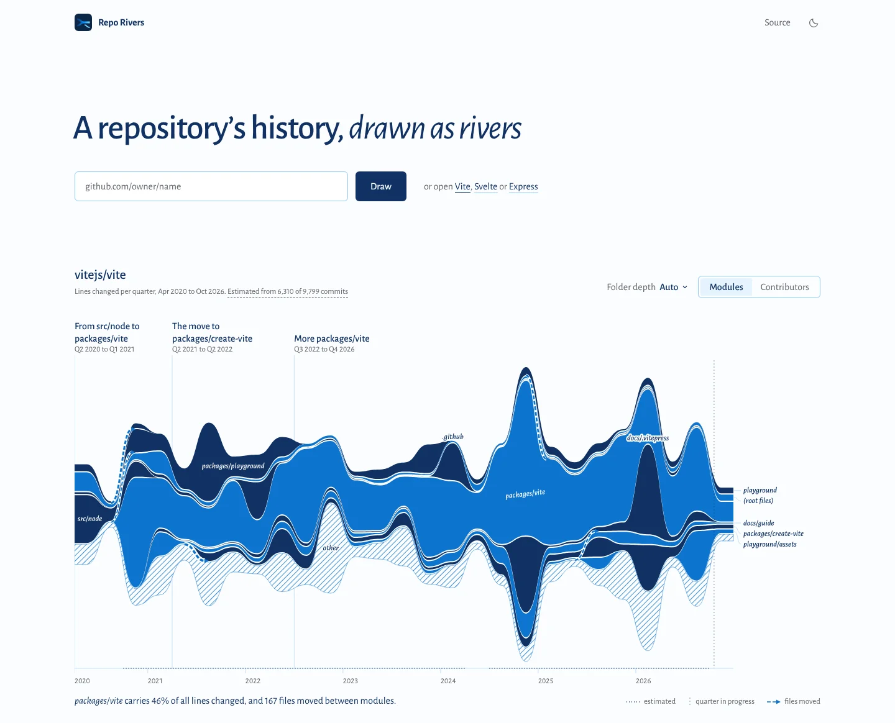

# repo-rivers

**See a GitHub repository's history as rivers.** Modules and contributors flow across time, widen when they get busy, and merge or split when the code is reorganised. Short era notes name the key periods.

**Live demo:** https://reporivers.geekplux.com

## Quick start

```sh
pnpm i            # Node 22 is fetched by pnpm (see .npmrc)
pnpm dev          # the web app on http://localhost:5173, with three built-in samples
pnpm dev:worker   # optional, in a second terminal: the API for pasting any public repo URL
```

No account and no API key. The built-in samples (Vite, Svelte, Express) render offline. Pasting `owner/name` or a GitHub URL also works without the Worker: the browser then reads GitHub directly, against your own rate limit.



More examples, with the story each sample tells: [the gallery](examples/README.md).

## What you can read from it

- **Which parts are alive.** Each river is a top-level folder (or a contributor). Its thickness is lines changed (or commits) in each week, month, quarter or year.
- **When the code was reorganised.** Dashed arrows show files moving from one folder into another, such as Svelte's `test` moving into `packages`.
- **Who carried each era.** Switch to Contributors to see the people behind each stretch of history. Bots are flagged and hidden by default.
- **Shareable views.** `?sample=svelte` or `?repo=owner/name` reproduce the view.

## How it works

1. **Read.** The [`fetchRepoAggregate`](src/core/github/fetchRepo.ts) function asks the GitHub REST API for the default branch's history (3 requests to size it up).
2. **Map paths to modules.** Lockfiles, build output and vendored code are ignored; each file counts at most 2,000 lines per bucket. Folders are kept to depth 3, so the depth control needs no refetch.
3. **Map commits to contributors.** A contributor is a GitHub login, or a hash of the email address. Merge commits are not counted.
4. **Bucket by time.** The smallest of week, month, quarter or year that gives at most 24 buckets (48 with a token; the Vite and Svelte samples were built with one, hence their 27 and 41 quarters).
5. **Draw flows.** A pure layout function turns the buckets into ribbons, transfers and direct labels in SVG. Runtime dependencies are `react` and `react-dom` only.

**Sampling and rate limits.** Unauthenticated GitHub access allows 60 requests per hour. Small repositories are read commit by commit. Larger ones are sampled with one comparison per bucket, which caps a fetch at 55 requests. The chart head says what was read ("Estimated from 6,310 of 9,799 commits") and opens the source notes. Results are cached in the Worker (Cloudflare KV) and in your browser: fresh for 24 h, kept up to 30 days and revalidated.

**The move-finder.** GitHub lists at most 300 files per comparison, which can hide a large reorganisation. When a folder first appears in such a bucket, repo-rivers finds the commit that created it and reads its renames, at about 3 to 6 extra requests per folder.

**Where AI is used: one place, naming eras.** Era boundaries are computed deterministically (an optimal partition of the timeline by module shares and activity). A language model (Workers AI) only writes a short title and note for each era, from a summary of at most 2 KB with no person names, no commit messages and no repository owner. The result is cached. Without AI, eras get template names, and the chart works with no eras at all.

More detail: [docs/EXTENDING.md](docs/EXTENDING.md) (public API, adapters, theming) and [docs/viz/rivers.md](docs/viz/rivers.md) (the visual encoding).

## Accessibility

- Meaning never relies on colour alone: rivers carry no hue, only two blues of different lightness so neighbours differ; rivers are named on the chart (or in the Rivers table) and keep a stable order; "other" is hatched, bots have a dotted edge and moved files are dashed arrows.
- The colours are Radix Colors blue and slate, light and dark, and are tested in code: both river blues have at least 3:1 contrast against the background and differ in lightness under protanopia, deuteranopia and tritanopia simulation, and text has at least 4.5:1.
- The chart is keyboard-operable: arrow keys move between rivers and time buckets (on a phone, where time runs down the page, Up and Down move through time), Home/End jump to the ends, Enter pins and Escape clears. Rows of the Rivers table and the eras are buttons too.
- Screen readers get a prose summary, a live readout of the focused river, and the Rivers table: every river with its total, share and active years.
- `prefers-reduced-motion` turns off every animation: the chart is drawn at once, with no reveal, fades or crossfades. The browser checks run axe on the sample, loading and error states.

Found a barrier? Please [open an issue](https://github.com/geekplux/repo-rivers/issues/new/choose).

## Privacy

- No analytics, no tracking, no cookies. The display font is self-hosted.
- Email addresses are never stored; they are only hashed in memory when a commit has no GitHub login.
- Nothing about people is sent to the AI model.
- Aggregates (counts per folder and per contributor name) are cached in Cloudflare KV and in your browser's `localStorage`.

## Deploy

The app and its API are one Cloudflare Worker. Prerequisites, the exact command (`pnpm build && pnpm exec wrangler deploy`), a smoke test and rollback are in [docs/DEPLOY.md](docs/DEPLOY.md). `pnpm build && pnpm run check:deploy` is a dry run that uploads nothing.

## Roadmap

- Export as SVG or PNG.
- Co-authored-by attribution.
- More sources: GitLab and local `git log` adapters.
- `src/core` as an npm package.

Candidate tasks for new contributors are in [docs/GOOD_FIRST_ISSUES.md](docs/GOOD_FIRST_ISSUES.md).

## Contributing

See [CONTRIBUTING.md](CONTRIBUTING.md), the [Code of Conduct](CODE_OF_CONDUCT.md) and the [security policy](SECURITY.md). Changes are listed in [CHANGELOG.md](CHANGELOG.md).

## Credits

- [geekplux/timeline-sankey](https://github.com/geekplux/timeline-sankey) (BSD-3-Clause): the inspiration for the ribbon shape, the dashed cross-links and hover dimming. repo-rivers is a rewrite; no code was copied.
- [Radix Colors](https://www.radix-ui.com/colors) (MIT): the blue and slate scales of the light and dark themes.
- [Alegreya Sans](https://github.com/huertatipografica/Alegreya-Sans) by Huerta Tipográfica, under the [SIL Open Font License](public/fonts/OFL.txt).

## License

[MIT](LICENSE)
