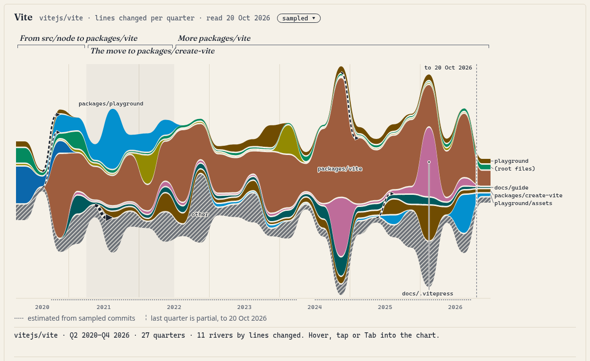
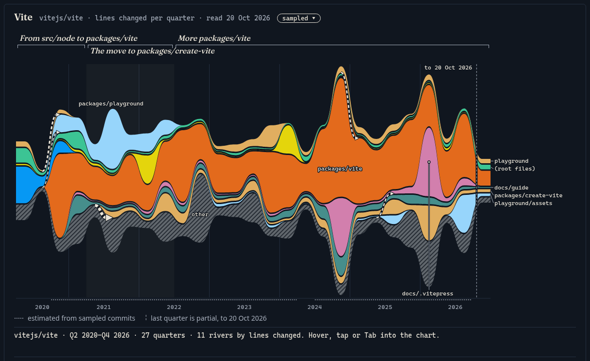
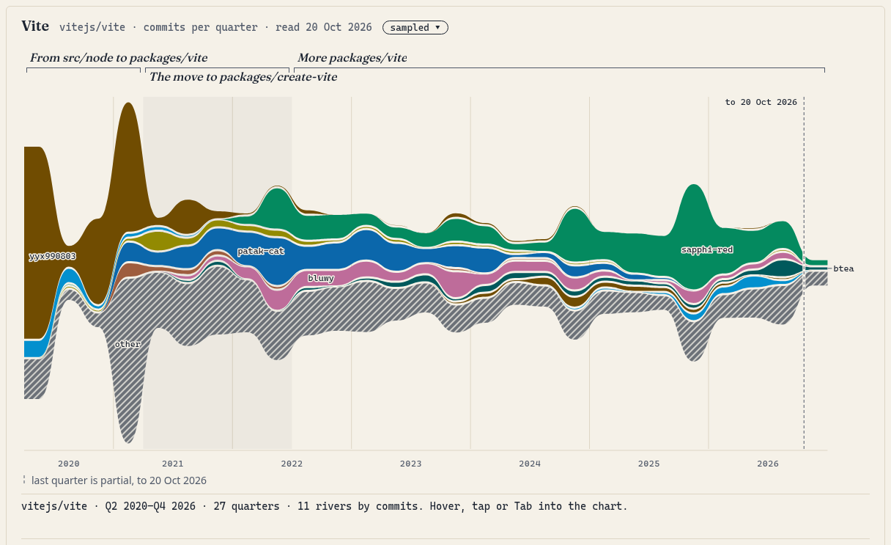
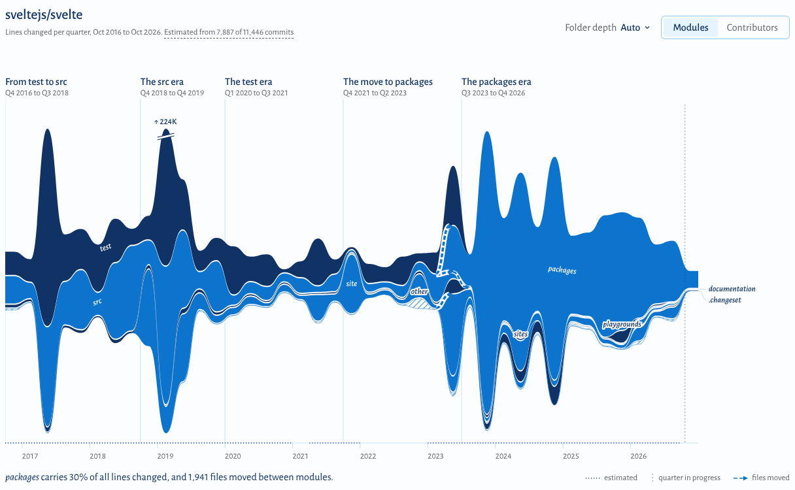
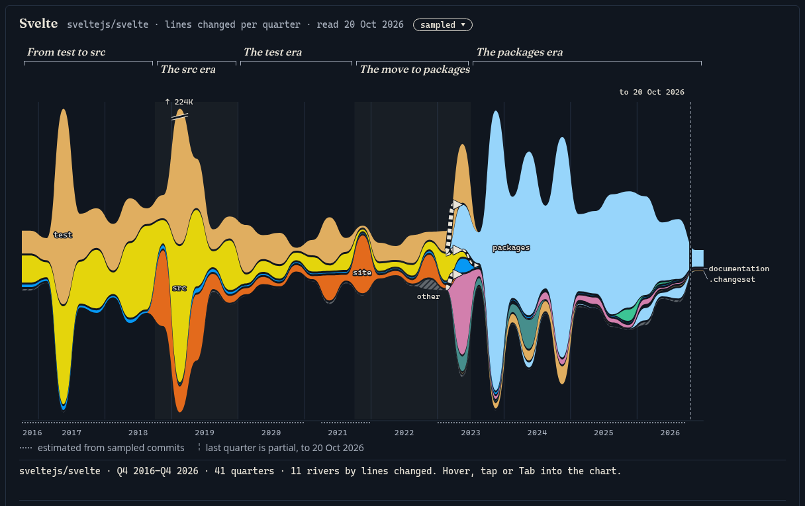
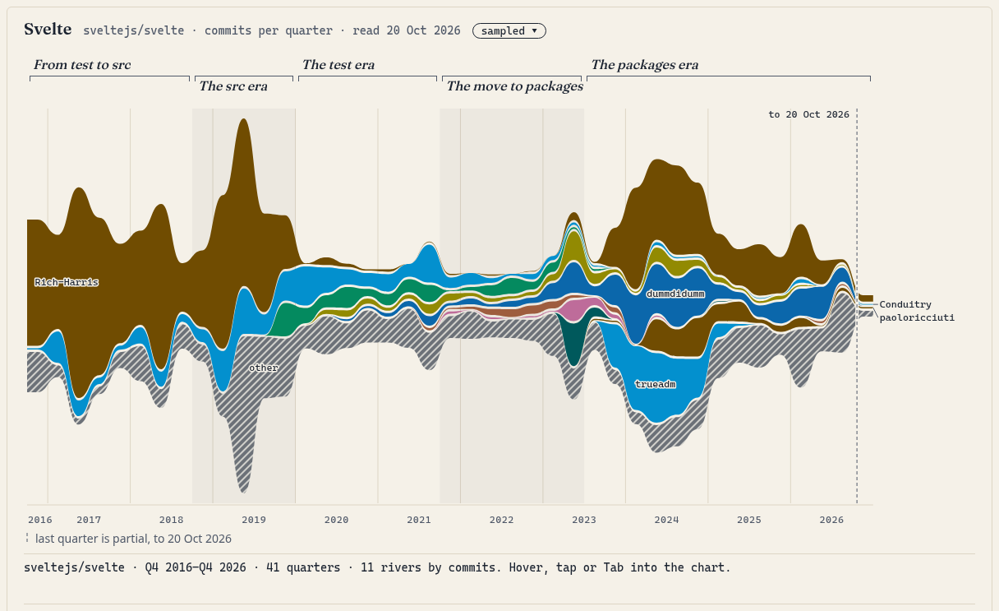
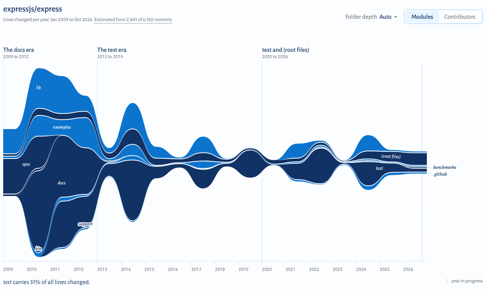
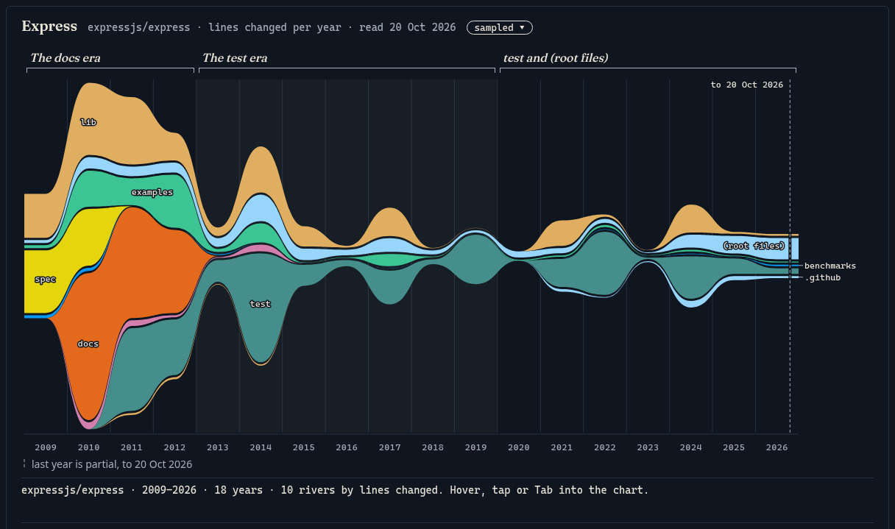
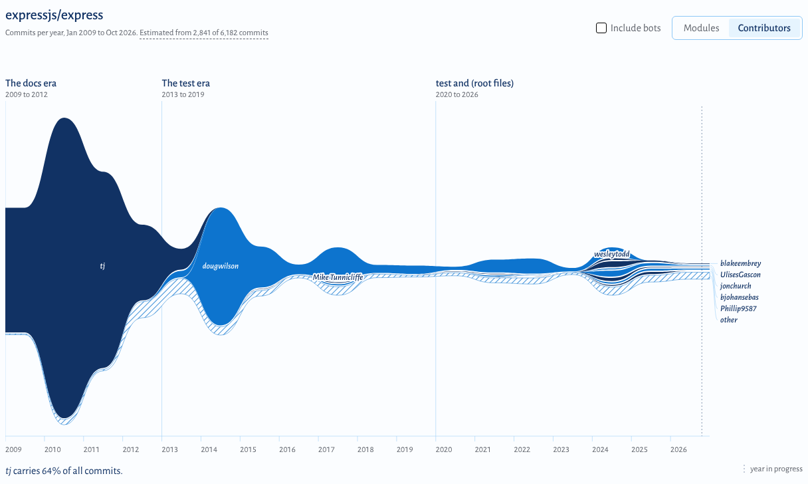

# Gallery

The three built-in samples, as `pnpm gallery` renders them. Each one opens instantly and offline, with no key: use the links below (or run `pnpm dev` and open the same `?sample=` paths on localhost). Every image is the chart card of the page at 1440 px wide; hover, tap or Tab into the live chart for exact numbers.

To regenerate these images, the social preview, the README image and the hero GIF: `pnpm build && pnpm gallery`.

## Vite: from `src/node` to `packages/vite`

[Open: `?sample=vite`](https://reporivers.geekplux.com/?sample=vite)

In spring 2020 Vite's code lived in `src/node` and a top-level `playground`. In Q4 2020 the repository took its monorepo layout: `packages/vite` appears and is the main river, and dashed arrows show `playground` moving into `packages/playground`. The era names follow the data: *From src/node to packages/vite*, *The move to packages/create-vite* (122 files moved in Q3 2021), then *More packages/vite*. The late bulge labelled `docs/.vitepress` is busy in Q4 2024 and Q1 2026.

| Dark theme | Contributors |
| --- | --- |
|  |  |

## Svelte: the Svelte 3 spike and the 2023 monorepo move

[Open: `?sample=svelte`](https://reporivers.geekplux.com/?sample=svelte)

Ten years in 41 quarters. The tallest column is Q1 2019, when `src` and `test` each changed by about 100,000 lines: the rewrite that shipped as Svelte 3. In Q2 2023 the repository moved to a monorepo: dashed arrows carry 952 files from `test`, 231 from `src` into `packages`, and 736 from `site` into `documentation`. After that, `packages` is almost the whole river, and it widens again from late 2023.

| Dark theme | Contributors |
| --- | --- |
|  |  |

## Express: a long, steady river

[Open: `?sample=express`](https://reporivers.geekplux.com/?sample=express)

From 2009 to 2026, one bucket per year. The early years are the busiest: `spec` flows in 2009 and 2010 and `docs` from 2010 to 2012, then both end, and `test` takes over from 2011. After 2015 the river is narrow and steady, `lib` and `test` year after year, with a bump in 2024 around the Express 5 release.

| Dark theme | Contributors |
| --- | --- |
|  |  |

## Social preview

[`?embed=social`](https://reporivers.geekplux.com/?embed=social) is a minimal 1280×640 card (logo, headline, chart). It accepts `&sample=`, and it is the source of [`docs/social-preview.png`](../docs/social-preview.png).
